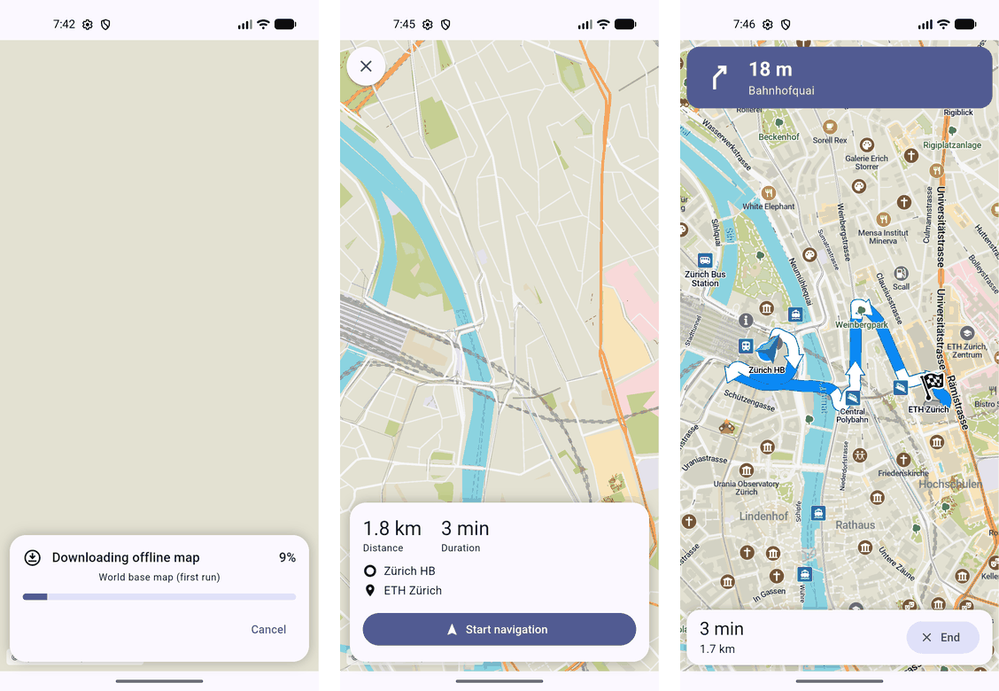
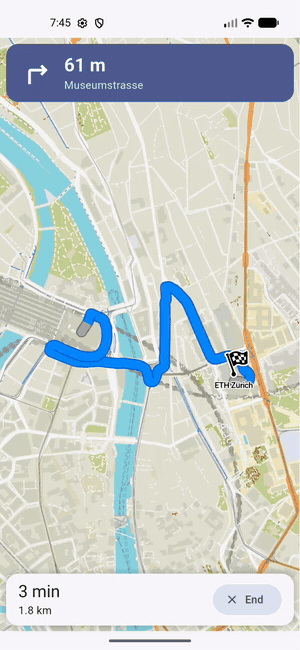
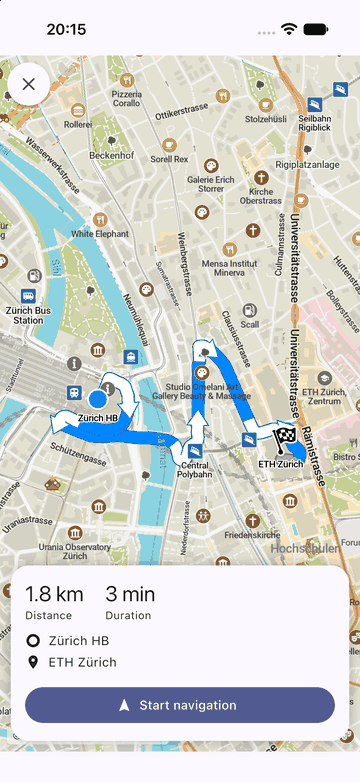
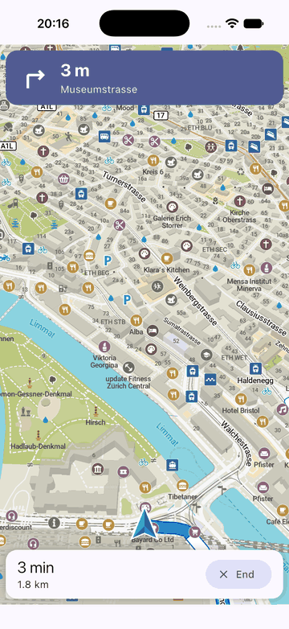

<h1 align="center">offline_navigation</h1>

<p align="center">
  <b>Turn-by-turn navigation for Flutter that keeps working with no internet.</b><br>
  One page, one call. Android and iOS.
</p>

<p align="center">
  <a href="https://pub.dev/packages/offline_navigation"></a>
  
  <a href="LICENSE"></a>
</p>

<p align="center">
  
</p>

Pass a start and a destination. The page downloads the offline map the trip needs,
shows the route, then guides the driver turn by turn, with spoken instructions.
After the one-time map download it needs no network. It runs on the engine of
[Organic Maps](https://organicmaps.app) with [OpenStreetMap](https://www.openstreetmap.org) data,
so there is **no API key, no account and no per-request billing**.

```dart
final result = await Navigator.push<NavigationResult>(
  context,
  MaterialPageRoute(
    builder: (_) => OfflineNavigationPage(
      start: NavPoint(latitude: 47.3779, longitude: 8.5403, name: 'Zürich HB'),
      destination: NavPoint(latitude: 47.3763, longitude: 8.5476, name: 'ETH Zürich'),
    ),
  ),
);
// result.outcome: arrived | cancelledByUser | failed
```

## Why use it

* **Works offline.** Routing, the map and the voice instructions all run on the device.
* **A whole navigation flow in one widget.** Engine start, map download with progress,
  route preview with distance and time, live guidance, lane hints, spoken turns.
* **Downloads only what the route needs.** A region of a country where the engine splits
  it, not the whole country. Show the size and ask first with one option.
* **Drive, walk or cycle.**
* **Android and iOS, the same API.**
* **Made for bad connections.** Prepare a small map of one park or city ahead of time and
  navigate there with the network off: [region maps](doc/region-maps.md).
* **Easy to demo and test.** A simulated drive needs no GPS.

## Quick start

### 1. Add the package

```sh
flutter pub add offline_navigation
```

The engine is bundled with your app on iOS (about 45 MB). On Android, Gradle downloads it
from Maven Central on your first build.

### 2. Android

Turn on core library desugaring in `android/app/build.gradle.kts` (needed when
`minSdkVersion` is below 26; the build fails with instructions if it is missing):

```kotlin
android {
  compileOptions {
    isCoreLibraryDesugaringEnabled = true
  }
}
dependencies {
  coreLibraryDesugaring("com.android.tools:desugar_jdk_libs:2.1.5")
}
```

That is all. Location permissions merge into your manifest by themselves, and the
user is asked for location when guidance starts.

### 3. iOS

iOS 15.0 or later. In `ios/Podfile`:

```ruby
platform :ios, '15.0'

post_install do |installer|
  installer.pods_project.targets.each do |target|
    flutter_additional_ios_build_settings(target)
    target.build_configurations.each do |config|
      config.build_settings['IPHONEOS_DEPLOYMENT_TARGET'] = '15.0'
    end
  end
end
```

In `ios/Runner/Info.plist`, the text iOS shows when it asks for location (without it the
prompt never appears and guidance cannot use the GPS):

```xml
<key>NSLocationWhenInUseUsageDescription</key>
<string>Your position is shown on the map and used for turn-by-turn directions.</string>
```

To keep guiding with the screen locked or the app in the background, add the `location`
background mode, and the `audio` mode so spoken instructions can play:

```xml
<key>UIBackgroundModes</key>
<array>
  <string>location</string>
  <string>audio</string>
</array>
```

### 4. Navigate

Use the snippet at the top of this page. It has two modes:

* **Real navigation (the default).** Guidance follows the device's GPS, so it is for a
  real trip. The user is asked for location permission when guidance starts.
* **Simulated drive.** To test, demo or just see how it works, with no GPS and no
  movement, add `simulateRoute`. The position marker drives the route for you, with the
  same route preview and turn instructions.

```dart
OfflineNavigationPage(
  start: start,
  destination: destination,
  options: const NavOptions(simulateRoute: true), // remove it for real navigation
)
```

> **First run:** the page downloads the base world map (72 MB) and the map pieces the trip
> needs, with a progress screen. Later trips in the same piece download nothing new.
> After that it works offline.

| Android | iOS |
|---|---|
| minSdk 21 | iOS 15.0, arm64 devices and Apple Silicon simulators (no Intel simulator) |

## What the user sees

<p align="center">
  
  &nbsp;
  
  &nbsp;
  
</p>

1. **Download.** If the maps are missing, a progress sheet names the map piece and its size.
2. **Preview.** The route on the map with distance and time.
3. **Guidance.** Next turn and its distance, lane hints, voice, and the remaining time and distance.
4. **Result.** The page closes and gives you a `NavigationResult`.

## Recipes

### Handle the result

```dart
switch (result?.outcome) {
  case NavigationOutcome.arrived:
    showArrivedMessage();
  case NavigationOutcome.cancelledByUser:
    break;
  case NavigationOutcome.failed:
    // result.failure: mapsMissing | downloadFailed | noRoute | engineError | other
    showError(result!.message);
  case null:
    break;
}
```

### Walk or cycle, no voice

```dart
OfflineNavigationPage(
  start: start,
  destination: destination,
  travelMode: TravelMode.walk, // drive (default), walk, cycle
  options: const NavOptions(voiceGuidance: false),
)
```

### Ask before downloading

```dart
options: const NavOptions(askBeforeDownload: true)
```

The page lists the map pieces and their sizes and waits for a "Download". Cancel closes it
with `NavigationOutcome.cancelledByUser`. It asks again if the route needs another piece.

### Download on Wi-Fi, before the trip

```dart
// What would this trip download? Asking downloads nothing.
final plan = await OfflineNavigation.planDownload(start: start, destination: destination);
print('${formatMapSize(plan.totalBytes)} to download');

// Which map piece (the API calls it a map area) is this point in? Download it:
final area = await OfflineNavigation.mapAreaAt(47.3779, 8.5403);
if (area != null && !area.isDownloaded) {
  await OfflineNavigation.downloadMapArea(
    area.id,
    onProgress: (p) => print('${((p.fraction ?? 0) * 100).round()} %'),
  );
}
await OfflineNavigation.ensureBaseMaps(); // the 72 MB base map, if you want it now
```

Do not run these while an `OfflineNavigationPage` is downloading: they share the engine's
one download-progress stream.

### Never use the network

```dart
options: const NavOptions(mapPolicy: MapPolicy.installedOnly)
```

The page routes only with maps already on the device. If one is missing it closes at once
with `NavigationFailure.mapsMissing`, and your app decides what to offer. Pair it with
[region maps](doc/region-maps.md) for places with no coverage at all.

## What gets downloaded

Map data is downloaded once and kept on the device. By default
(`MapPolicy.autoDownloadCountry`) the page downloads only what the trip needs:

1. **The map piece for the start and the one for the destination.** The world's maps
   come in downloadable pieces. A small country is one piece. A big country is split into
   several (for example a northern and a southern part), so a trip inside one part does not
   need the whole country. Pieces range from about 20 MB to a few hundred MB.
2. **The base world map** (72 MB), once. It draws the world around those pieces.

A trip that stays inside one piece downloads one piece. A trip that crosses into another
piece downloads that one too and carries on. Pieces you already have are never downloaded
again. (In the API they are called map areas.)

For example, Zürich HB to ETH Zürich downloaded the 72 MB base map and one 59 MB piece. A
later trip inside that piece needs nothing new.

Want to show the size first, or download ahead of time? See the recipes above.

## Options at a glance

`NavOptions`:

| Option | Default | What it does |
|---|---|---|
| `voiceGuidance` | `true` | Speaks the turns with the device's text to speech. |
| `simulateRoute` | `false` | Drives the route automatically, with no GPS. For demos and tests. |
| `mapPolicy` | `autoDownloadCountry` | `installedOnly` never uses the network. |
| `askBeforeDownload` | `false` | Shows the map pieces and their sizes and waits for a "Download". |

### Start the engine early

The engine starts on its own when the page opens. To make the first open faster, warm it
up earlier, for example when your app starts:

```dart
await OfflineNavigation.initialize(); // safe to call more than once
```

### Just show the map

`OfflineMapView` is the bare offline map widget, without the navigation screens. Call
`OfflineNavigation.initialize()` first and let it finish before you build the widget.

The [API reference](https://pub.dev/documentation/offline_navigation/latest/) lists everything.

## Good to know

* **You choose the start point.** `start` is a position you pass in. To navigate from where
  the user is now, read their location with a location package and pass it as `start`.
* **The page takes the whole screen** and returns a `NavigationResult` when it closes.
* **The built-in screens are in English** for now (download, preview, buttons).

## Troubleshooting

* **Android build fails about desugaring.** Add the two blocks from step 2.
* **iOS never asks for location.** `NSLocationWhenInUseUsageDescription` is missing from
  `Info.plist`.
* **iOS stops guiding when the screen locks.** Add the `location` background mode. A
  simulated drive is not kept alive in the background, because it has no location
  updates: it carries on from where it was when the app returns.
* **No Intel iOS simulator.** The engine is arm64 only: use a device or an Apple Silicon simulator.
* **The page closes with `mapsMissing`.** With `installedOnly`, the installed maps do not
  cover the route. Both the start and the destination must be inside installed maps.
* **A download failed.** The page shows the error with a retry. Check the connection and try again.

## Try the example

The [`example`](example) app lets you pick a route, a travel mode and the options, and
install a region map.

```sh
cd example && flutter run
```

## How it works

The map surface is embedded in your widget tree as a platform view. All navigation UI
(instruction banner, lane hints, ETA bar, download and preview screens) is drawn in
Flutter and fed by native event streams. The engine, with rendering, routing and map
management, is the same C++ core as the Organic Maps app. It is a prebuilt AAR on Android
(`io.github.fred-apina:organicmaps-sdk`) and a prebuilt XCFramework (`OfflineNavEngine`)
on iOS, both built from the same engine fork.

## Feedback and contributing

Bugs and ideas are welcome in the
[issue tracker](https://github.com/fred-apina/offline_navigation/issues). If something in this
guide was unclear, tell us: the goal is that you are navigating in minutes.

## License and attribution

Apache-2.0, built on the [Organic Maps](https://github.com/organicmaps/organicmaps)
engine (Apache-2.0). Map data © [OpenStreetMap](https://www.openstreetmap.org/copyright)
contributors (ODbL); the map widget shows a permanent attribution notice.
